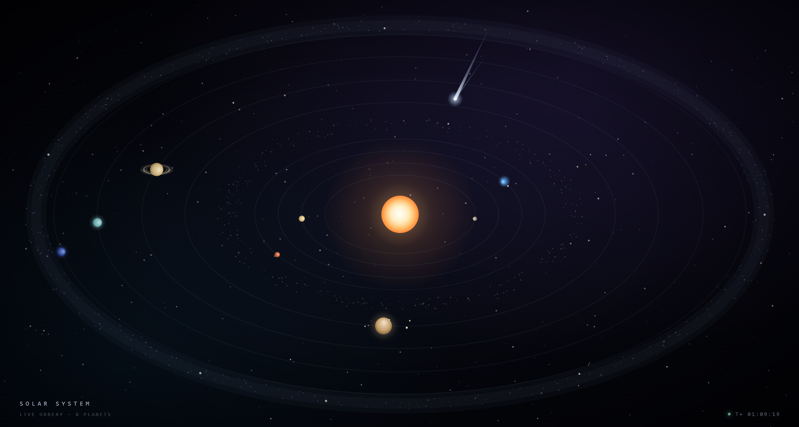
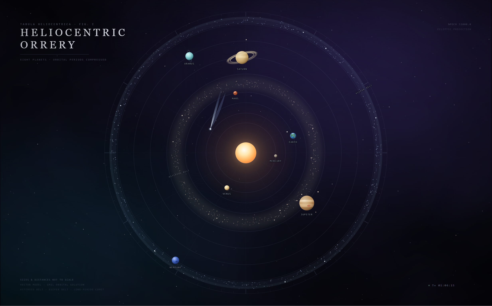

# Solar System · 太阳系仪

一个纯静态的太阳系可视化项目，提供 **Canvas 实时版**（`canvas.html`）与 **SVG 矢量版**（`svg.html`）两种独立渲染。两版都包含太阳、八大行星、冥王星、卫星、行星环、小行星带、柯伊伯带与长周期彗星，并配有背景音乐、视图切换和播放结束后的自动轮换。

无需构建工具，无前端依赖，直接用浏览器打开即可。两个渲染页面均为单文件（内联 CSS/JS），唯一的外部资源是各自的 MP3 背景音乐。

## 预览

**Canvas 实时版**（`canvas.html`）：



**SVG 矢量版**（`svg.html`）：



## 快速开始

```bash
cd /data/code/solar-system
python3 -m http.server 8000
```

然后打开：

- 默认入口（SVG 版）：<http://localhost:8000/>
- Canvas 版：<http://localhost:8000/canvas.html>
- SVG 版：<http://localhost:8000/svg.html>

根目录的 `index.html` 是一个跳转页，会把默认访问（如 `http://172.16.10.213:8090/`）导向 `svg.html`。

> 建议通过本地 HTTP 服务访问。直接双击 `file://` 通常也能看到画面，但浏览器的自动播放策略、跨页面跳转和音频行为可能因环境而异。

## H5 部署

当前内网 H5 由 systemd 服务 `solar-preview.service` 提供，直接以静态方式服务本仓库目录：

- 服务：`solar-preview.service`（`python3 -m http.server 8090`，用户 `nobody`，已设为开机自启）
- 服务目录：`/data/code/solar-system`
- 默认入口：<http://172.16.10.213:8090/>（自动跳转到 SVG 版）
- Canvas：<http://172.16.10.213:8090/canvas.html>
- SVG：<http://172.16.10.213:8090/svg.html>

更新页面文件后重新部署并检查：

```bash
systemctl restart solar-preview.service
systemctl is-active solar-preview.service
curl -I http://127.0.0.1:8090/
curl -s http://127.0.0.1:8090/ | grep 'url=svg.html'
```

说明：

- 服务直接读取仓库文件，静态内容更新后无需构建；重启仅用于确保服务状态干净。
- `git push` 只同步 GitHub，不会改变本机 8090 的页面内容。
- 若浏览器仍显示旧页面，强制刷新（`Ctrl/Cmd+Shift+R`）即可。
- 首次部署或服务管理：`systemctl enable --now solar-preview.service` / `systemctl stop solar-preview.service`。
- 当前 preview 使用 Python 自带 `http.server`，不支持 Range 请求，MP3 不能拖动进度；正式对外部署建议换成 nginx 等静态服务器。

## 功能

- **两种渲染**：Canvas 2D（`requestAnimationFrame`）与 SVG + SMIL（`animateMotion`），可随时通过右上角 `Canvas` / `SVG` 按钮切换。
- **天体**：太阳、水星、金星、地球、火星、木星、土星、天王星、海王星，以及柯伊伯带中的矮行星冥王星。
- **卫星**：
  - Canvas：地球 1、火星 2（火卫一/火卫二）、木星 4、土星 3（土卫五 Tethys、土卫六 Titan、土卫八 Iapetus）。
  - SVG：地球 1、火星 2、木星 4、土星 3（土卫五 Tethys、土卫六 Titan、土卫八 Iapetus）。
- **行星环**：土星的完整多层环；天王星、海王星、冥王星的细环（视觉上代表其卫星）。
- **深空元素**：小行星带、柯伊伯带、长周期彗星、星空与星云背景。
- **背景音乐**：Canvas 版为《星际缓航》，SVG 版为《行星脉动》；音乐胶囊按钮支持播放/暂停，音量带淡入淡出。
- **自动轮换**：当前视图的音乐自然播放完毕后，页面自动切换到另一视图，并由目标页面尝试开始播放其音乐，如此循环。手动暂停音乐时不会触发切换（目标页面的自动播放仍受浏览器策略约束）。
- **自动播放回退**：页面加载时先尝试带声音自动播放（浏览器允许时会直接响起）；若被浏览器拦截（Chrome/Edge 默认策略），页面会立即以静音方式自动播放（利用浏览器允许的静音 `<video>` 起播），按钮显示「点击开启声音」，用户首次点击、触摸或按键时立即取消静音。若连静音起播也被拦截，则在首次交互时从头发声播放。Chrome/Edge 默认策略下，零交互带声自动播放无法由页面代码绕过；如需首开即出声，见下文「让部署端无需交互自动播放」。
- **响应式**：Canvas 随窗口尺寸重绘（DPR 上限 2）；SVG 使用 `viewBox` + `preserveAspectRatio` 适配不同比例。
- **减少动态**：检测 `prefers-reduced-motion: reduce`；Canvas 只绘制一帧静态画面，SVG 暂停 SMIL 动画。
- **可访问性**：Canvas `role="img"` + `aria-label`；SVG `role="img"` + `<title>`/`<desc>`；音乐按钮使用 `aria-pressed` 与动态 `aria-label`。

## 两版对比

| | Canvas 版 | SVG 版 |
|---|---|---|
| 文件 | `canvas.html` | `svg.html` |
| 渲染 | Canvas 2D + `requestAnimationFrame` | SVG + SMIL |
| 行星标签 | 无（仅 HUD 标题） | 有（每个行星一个 `plabel`） |
| 卫星 | 地球 1、火星 2、木星 4、土星 3（土卫五/土卫六/土卫八） | 地球 1、火星 2、木星 4、土星 3（土卫五/土卫六/土卫八） |
| 行星环 | 土星完整环 + 天王星/海王星/冥王星细环 | 同左 |
| 冥王星 | 有（1.03 轨道，柯伊伯带内） | 有（半径 436 轨道，柯伊伯带内） |
| 背景音乐 | 《星际缓航》 | 《行星脉动》 |
| 轨道投影 | 椭圆投影 `y *= 0.52` | 正圆 `animateMotion` 路径 |

## 目录结构

```text
solar-system/
├── index.html          # 默认入口：跳转到 SVG 版
├── canvas.html         # Canvas 实时版
├── svg.html            # SVG 矢量版
├── solar.png           # Canvas 版预览截图
├── orrery.png          # SVG 版预览截图
├── 星际缓航.mp3         # Canvas 版背景音乐
├── 行星脉动.mp3         # SVG 版背景音乐
├── README.md
└── .gitignore
```

> 本地工作目录还可能包含 `.orchestrator/`（测试证据）、`.remember/`（会话记忆）和 `gen_solar.py`（一次性辅助脚本）。它们已写入 `.gitignore`，不纳入版本库，也不是页面运行依赖。

## 操作

- **切换视图**：点击右上角的 `Canvas` / `SVG`。
- **音乐**：点击左上角音乐胶囊播放/暂停；首次点击页面其他区域或按键也会尝试启动音乐。
- **自动轮换**：保持音乐播放，等待当前曲目自然结束；页面会切换到另一版并尝试继续播放。若手动暂停，则不会自动切换。

## 技术说明

### Canvas（`canvas.html`）

- 每帧 `clearRect` 后依次绘制星空、柯伊伯带、小行星带、轨道、行星（按 y 轴分前后两层）、太阳、彗星。
- 行星显示半径为手工压缩值，轨道周期也经过压缩，仅用于视觉呈现，不代表真实比例。
- 轨道采用椭圆投影：`x = cx + cos(a)·orbit·rxMax`，`y = cy + sin(a)·orbit·rxMax·0.52`。
- 行星环（土星主环与天王星/海王星/冥王星的细环）按“背面 → 本体 → 正面”的顺序绘制，以形成遮挡关系；土星主环与 SVG 版一致（C/B/A 三条椭圆描边，整体倾斜 −16°，正面半环更亮）；卫星在本体之后绘制。

### SVG（`svg.html`）

- 画布为 `viewBox="0 0 1600 1000"`，场景中心 `translate(800 500)`。
- 行星与卫星使用圆形 `animateMotion` 路径；`begin` 使用负值设置初始相位。
- 星空、小行星带、柯伊伯带、刻度等由页面底部的一小段 JavaScript 生成；行星运动本身不依赖 JS。
- 土星环由三条椭圆描边组成；天王星、海王星、冥王星的细环由“背面椭圆 + 正面半弧”组成。

### 自动轮换与音乐

- 两版各自持有 `OTHER_VIEW`，音乐自然结束时通过 `location.replace()` 跳转到另一版，避免历史记录堆积。
- 背景音乐由隐藏的 1px `<video>` 元素承载：Chrome 只允许静音 `<video>` 无手势自动播放，`<audio>` 的静音起播同样会被拦截。
- `<video>` 故意不设置 `loop`，否则不会触发自然结束事件；静音自动播放期间（用户尚未开启声音）曲目结束会从头循环，不触发视图轮换，避免无声跳转。
- 使用 `rotating` 防抖与 `userPaused` 标记，区分“自然播完”和“用户主动暂停”。

## 浏览器要求

- 现代 Chrome / Edge / Firefox / Safari（需支持 Canvas 2D、ES6 与 SMIL 动画）。
- 背景音乐的自动播放受浏览器策略影响：Chrome/Edge 默认会拦截无交互的带声音自动播放（静音 `<audio>` 也会被拦截）。页面会先静音自动播放，并在首次点击/触摸/按键时立即开启声音；零交互出声需按下一节配置浏览器。
- “减少动态”依赖 `prefers-reduced-motion` 媒体查询。

### 让部署端无需交互自动播放

浏览器默认禁止无交互的带声自动播放，页面代码无法绕过。若需要首开即出声，可在查看端做以下任一配置：

- 浏览器站点设置：Chrome / Edge 地址栏左侧站点信息 → 声音 → 允许；Firefox 设置 → 隐私与安全 → 自动播放 → 允许音频和视频。刷新页面后生效。
- Chrome / Edge 启动参数：`--autoplay-policy=no-user-gesture-required`
- Linux 受管策略：在 `/etc/opt/chrome/policies/managed/autoplay.json` 写入 `{"AutoplayAllowed": true}`
- Android WebView：调用 `WebSettings.setMediaPlaybackRequiresUserGesture(false)`

## 已知限制

- **非真实比例**：行星大小、轨道距离与公转周期均为视觉压缩，不用于天文计算。
- **冥王星定位**：冥王星按矮行星处理，因此界面中的 “8 planets” / “EIGHT PLANETS” 文案保持不变。
- **小屏幕**：在 390px 宽度附近，部分卫星与细环会缩小到亚像素级，仍然存在并运动，但不易辨认。
- **无构建/测试体系**：项目是纯静态页面，没有打包、单元测试或依赖管理；验证依赖静态检查与浏览器运行时检查。
- **音频文件较大**：两首 MP3 均为约 7 MB，首次加载需要一定带宽。
- **未声明许可证**：如需分发或复用，请先确认素材（音乐、代码）的授权情况。

## 自定义

- **更换音乐**：替换对应 MP3，并同步修改页面中的 `<video src="...">`、`data-track`、按钮文案与 `aria-label`。
- **调整行星**：Canvas 版修改 `PLANETS` 数组；SVG 版修改对应 `<g class="planet">` 与 `animateMotion` 路径。
- **保持两版一致**：两版是独立实现，没有共享配置；若要让 Canvas 与 SVG 表现一致，需要同时修改两个文件。
